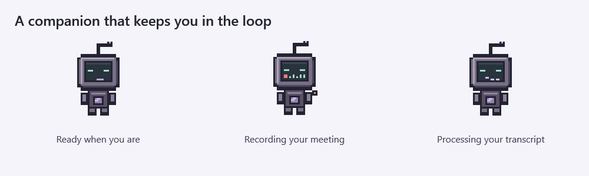
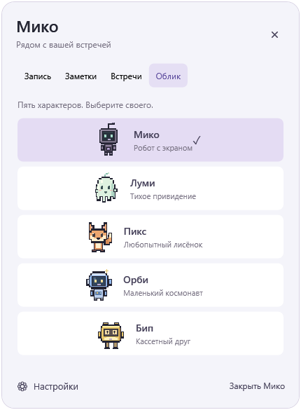
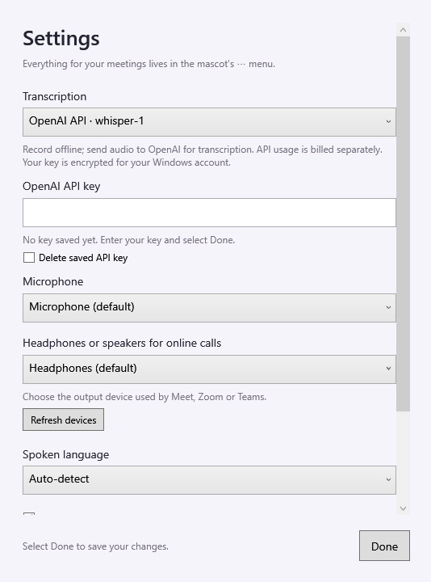

<div align="center">

# Miko

### A little desktop companion for your meetings.

Record a conversation. Keep the transcript. Stay in the moment.

**Windows 10/11 · Five animated mascots · OpenAI Whisper · Optional offline transcription**

[**Download for Windows**](https://github.com/omertaevalibekai/miko-meeting-assistant/releases/latest) · [Build from source](BUILDING.md) · [Test results](TEST-RESULTS.md)


</div>

Miko is a small, draggable Windows companion that records in-person meetings and online calls, then saves the audio, a timestamped transcript, notes and a short summary. Everything starts from the **⋯ button on your mascot**. Recording, notes, meeting history and appearance stay in its attached menu; only **Settings** opens a separate window.

**New in v0.4.0:** an English interface, English status and error messages, English summary headings, automatic spoken-language detection for new installations, and a refreshed visual guide. Existing language preferences and meeting files are preserved.

## See it in action



*Actual app-rendered animation states, shown with a simulated recording level. No microphone or meeting audio was used to create these previews.*

<table>
  <tr>
    <td align="center"><strong>One menu for every meeting</strong></td>
    <td align="center"><strong>Pick your companion</strong></td>
  </tr>
  <tr>
    <td></td>
    <td></td>
  </tr>
</table>

## Get started

1. **Download and extract** the entire `Miko-Windows.zip` from [Releases](https://github.com/omertaevalibekai/miko-meeting-assistant/releases/latest), then open `Miko.exe`. Keep its files together in a writable folder. Windows 10/11 x64 with .NET Framework 4.8 is required; Python and Node.js are not needed.
2. **Set up once:** open **⋯ → Settings**, select your microphone and call output device, then enter your OpenAI API key and select **Done**. Or choose **On this computer · Whisper base** for offline transcription; the release archive includes the local engine and models.
3. **Record:** open **⋯ → Record**, name the meeting, choose **In person** or **Online call**, and select **Start recording**. Select **Stop and save** when finished. Transcription starts automatically using your chosen provider.
4. **Review:** open **⋯ → Meetings** for the summary, transcript, timestamps, notes and audio playback. Use **Copy** to copy the displayed document.

Drag the mascot by its body to move it. Closing the menu, pressing Escape or clicking outside it leaves recording running. **Quit Miko** is inside the same menu. The microphone starts only when you explicitly start a recording.

## Two ways to record

| Mode | What Miko captures | Best for |
|---|---|---|
| **In person** | Your selected microphone | A conversation in the room, voice notes |
| **Online call** | Your microphone + all audio from the selected headphones or speakers | Google Meet, Zoom, Teams and other calling apps |

Online recording uses Windows WASAPI loopback. Choose the **same output device in your calling app and Miko**. No meeting bot or service-account connection is required. Other sounds on that device, including music and notifications, are also recorded. Headphones help avoid capturing the other person's voice twice through your microphone.

Recording works without internet in both modes. The limit is **2 hours per recording**. Starting calls automatically, detecting meetings, speaker identification and Windows auto-start are not implemented.

## Five companions, one workflow

| Miko | Lumi | Pix | Orbi | Beep |
|---|---|---|---|---|
| Purple screen robot | Gentle mint ghost | Curious orange fox | Tiny blue astronaut | Yellow cassette pal |

Each companion blinks, gently sways and responds to recording. It stays where you put it. Your choice is saved, motion pauses while dragging, and animation can be disabled in Settings. Miko also respects Windows animation preferences.

## Whisper, your way



| | OpenAI API — default | On this computer |
|---|---|---|
| Model | **`whisper-1`** | **Whisper base multilingual**, via whisper.cpp |
| Internet | Required for transcription | Not required after downloading the release |
| API key | Your own OpenAI key | Not needed |
| Audio processing | Audio is sent to OpenAI after recording stops | Audio stays on your computer |
| Cost | Billed to your OpenAI API project | No API charges |

The **Spoken language** setting offers Auto-detect, English, Russian and Kazakh. The interface is English; transcripts retain the language spoken in the meeting. Existing installations keep their selected language.

Your API key is saved in `openai-key.dpapi`, encrypted for your current Windows account. It is not stored in settings JSON, source code or logs. Leave the key field empty to keep the current key; enter a new key to replace it, or use **Delete saved API key**. Enter it again after moving to another computer or Windows account.

Without a key, Miko still saves the audio. Add your key later, select the meeting and choose **Retry**. There are no automatic retries of paid requests. **Retry** processes the whole meeting again and can incur repeat charges; cancellation cannot undo a request already received by OpenAI.

Long recordings are sent in sequential WAV chunks of about 10 minutes, each under 25 MB. Boundaries use a quiet interval near the end of each chunk, and timestamps are combined into one timeline. Continuous speech at a boundary may still be transcribed imperfectly.

**Model availability:** OpenAI's [deprecation notice](https://developers.openai.com/api/docs/deprecations) lists `whisper-1` for retirement on **February 26, 2027**. Miko does not silently switch cloud models. Local Whisper remains available. See the official [speech-to-text guide](https://developers.openai.com/api/docs/guides/speech-to-text) for API details.

## What you keep

Each meeting gets its own folder inside `Meetings/`, beside the application:

```text
Meetings/<date>_<id>/
├── audio.wav          Mixed recording · mono 16 kHz PCM16
├── microphone.wav     Original microphone track
├── computer.wav       Original output track · online mode only
├── transcript.txt     Full transcript
├── transcript.srt     Timestamped transcript
├── summary.md         Highlights and possible next steps
├── notes.txt          Notes attached to this meeting
├── meeting.json       Date, duration, devices, status and model
└── recognition.log    Local engine log or successful API/model record
```

The **summary is extractive**: Miko selects up to five key sentences and possible action statements locally. It does not use a generative language model or invent a rewritten meeting report. Summary headings are English; selected sentences remain in their original language. Check names, decisions and deadlines against the recording.

Notes save automatically. Notes written during recording belong to that meeting; otherwise they are a draft for the next one. Your notes are not sent to OpenAI. Meeting files are stored unencrypted in the app folder. Let participants know before recording.

## Updates and troubleshooting

- **Updating:** quit Miko, back up your app folder, and copy the new release files into it. Keep `Meetings/`, `settings.json`, `draft-notes.txt` and `openai-key.dpapi`. Release archives contain no personal recordings, settings or API keys.
- **No microphone audio:** check the device in Settings and Windows permission for desktop apps to access the microphone.
- **No remote voices:** match Miko's output device to the output selected in Meet, Zoom or Teams.
- **API error:** check your internet connection, API key, project balance and model access, then select the meeting and choose **Retry**. Audio and any previous transcript are retained after a processing failure or cancellation.
- **Need to cancel:** use **⋯ → Record → Cancel processing**. A new recording can start once processing ends.
- **Changed or disconnected a device:** stop recording, select the correct devices and start a new recording.

Keep the app folder in place while Miko is running. Force-quitting may lose the final second of recording; recovery of a damaged WAV is not guaranteed.

## Development and verification

Miko is a working Windows prototype built with **C# / WPF, .NET Framework 4.8, NAudio 2.2.1 and whisper.cpp**. See [BUILDING.md](BUILDING.md) for the one-command build, [DEPENDENCIES.md](DEPENDENCIES.md) for pinned components, and [licenses/](licenses/) for third-party notices. Release archives include per-file SHA-256 checksums.

The English build passes core audio tests, UI interaction tests and mocked OpenAI API tests, including chunk integrity, timestamps, error handling, cancellation and DPAPI key storage. Previous local-engine validation used the public JFK audio sample. **Live OpenAI authentication and live Meet/Zoom/Teams calls have not been tested.** No personal microphone capture or user recording was used for these checks. Full scope: [TEST-RESULTS.md](TEST-RESULTS.md).
