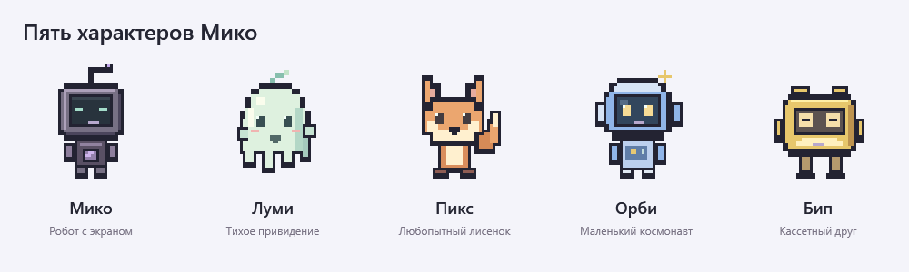
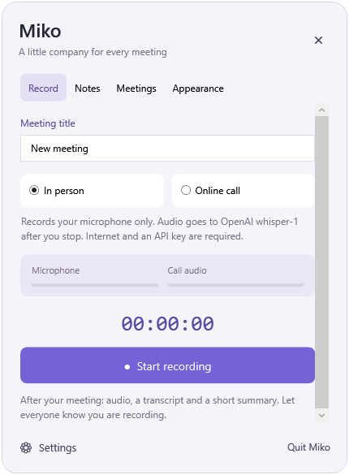

# Miko — маскот для записи встреч

Анимированный помощник для рабочего стола Windows: запись микрофона и системного звука, OpenAI Whisper API, локальное распознавание, заметки и краткий итог.

**[Скачать версию для Windows](https://github.com/omertaevalibekai/miko-meeting-assistant/releases/latest)** · **[Собрать из исходников](BUILDING.md)**

## Версия 0.3

Рабочий прототип для Windows 10/11 x64. По умолчанию речь распознаётся через **OpenAI API, модель `whisper-1`**. Запись аудио работает без интернета; для расшифровки нужны интернет и ваш API-ключ. Python и Node.js не требуются. Приложение использует .NET Framework 4.8.

## Запуск и управление

1. Откройте **Miko.exe**. Появится только маскот. Из ZIP сначала извлеките все файлы; при переносе копируйте всю папку.
2. Перетаскивайте персонажа за тело. Все действия начинаются с **«⋯» на маскоте**: открывается прикреплённая панель рядом с ним.
3. В **«⋯ → Настройки»** выберите устройства, вставьте ключ в поле **«API-ключ OpenAI»**, нажмите **«Готово»**. Это единственное отдельное обычное окно.
4. **«⋯ → Запись»**: название встречи, режим «В комнате» или «Онлайн-звонок», «Начать запись». Остановить запись можно там же. После остановки начинается расшифровка выбранным способом.
5. **«⋯ → Заметки»**: заметки сохраняются автоматически; во время записи прикрепляются к встрече. **«⋯ → Встречи»**: итог, текст, таймкоды, прослушивание аудио внутри панели и копирование текста.
6. **«⋯ → Облик»** переключает персонажа. **«⋯ → Закрыть Мико»** завершает приложение. Если операция активна, подтверждение показывается в той же панели.

Крестик панели, Escape или щелчок снаружи закрывают только панель: запись продолжается. При запуске приложения микрофон не включается. Запись запускается вручную; автоматическое обнаружение звонков и автозапуск Windows пока не добавлены.

## Пять вариантов

| Имя | Образ |
|---|---|
| Мико | Фиолетовый робот с экраном |
| Луми | Мятное привидение |
| Пикс | Рыжий лисёнок |
| Орби | Голубой космонавт |
| Бип | Жёлтый кассетный персонаж |

Выбор сохраняется. Каждый маскот моргает, мягко покачивается и реагирует на запись. Самостоятельно по экрану не перемещается. Анимация отключается в настройках; также учитывается настройка анимации Windows. Во время перетаскивания движение приостанавливается.

## Запись встреч

**В комнате:** только выбранный микрофон; запись доступна без интернета.

**Онлайн-звонок:** микрофон и весь звук выбранных наушников/колонок через Windows WASAPI. В Google Meet, Zoom, Teams или другом приложении выберите то же устройство вывода, что и в Мико. Бот и подключение к аккаунту сервиса не нужны. В запись также попадут музыка и уведомления этого устройства. Наушники помогают избежать повторного попадания звука собеседника в микрофон.

Уровни звука показываются во время записи. Если устройство отключили или заменили, остановите запись и выберите устройства заново. При ошибке захвата приложение сохраняет запись и предупреждение. Лимит одной записи — 2 часа.

## Распознавание и API-ключ

В облачном режиме используется `POST https://api.openai.com/v1/audio/transcriptions`, модель **`whisper-1`**, формат `verbose_json` с таймкодами сегментов. Есть русский, английский, казахский и автоопределение языка. Разделения по именам говорящих нет.

API оплачивается вашим проектом OpenAI отдельно. Ключ хранится в `openai-key.dpapi`, зашифрованном Windows для текущей учётной записи; он не записывается в JSON настроек или журналы. Пустое поле оставляет существующий ключ, новый заменяет его; для удаления есть флажок. После переноса на другой компьютер или другую учётную запись введите ключ заново.

Без ключа аудио всё равно сохранится. После добавления ключа выберите встречу и нажмите **«Повторить»**. В настройках также доступен вариант **«На компьютере · Whisper base»**: локальная модель включена в дистрибутив и работает без интернета.

Длинное аудио отправляется последовательными WAV-частями примерно по 10 минут, каждая меньше 25 МБ. Граница выбирается в наиболее тихом участке последних 15 секунд. Все исходные сэмплы сохраняются, таймкоды объединяются в общую шкалу. На стыках непрерывной речи возможны ошибки распознавания.

Автоматических повторов платного запроса нет. Кнопка «Повторить» обрабатывает всю встречу заново, включая ранее успешно отправленные части; запросы могут оплачиваться повторно. Отмена прекращает ожидание и дальнейшую отправку, но уже отправленная часть могла быть обработана сервером.

По [официальной документации OpenAI](https://developers.openai.com/api/docs/deprecations), отключение `whisper-1` запланировано на **26 февраля 2027 года**. Автоматической подмены другой облачной моделью нет. Документация: [формат запроса](https://developers.openai.com/api/reference/resources/audio/subresources/transcriptions/methods/create), [ограничения размера](https://developers.openai.com/api/docs/guides/speech-to-text).

## Результаты встречи

В папке `Meetings` рядом с программой для каждой встречи сохраняются:

- `audio.wav` — общая запись PCM16, 16 кГц, моно;
- `microphone.wav` и, в онлайн-режиме, `computer.wav` — исходные дорожки;
- `transcript.txt` и `transcript.srt` — текст и таймкоды;
- `summary.md` — краткий итог, возможные следующие шаги;
- `notes.txt` — ваши заметки;
- `meeting.json` — время, режим, статус, устройства и модель завершённой расшифровки;
- `recognition.log` — журнал локального движка либо название сервиса/модели при успешном запросе API.

**Краткий итог — локальный выбор до пяти ключевых фраз и фраз с возможными задачами/сроками.** Генеративная языковая модель для него не используется. Имена, решения и сроки следует проверить по аудио.

В режиме OpenAI API аудио отправляется в OpenAI для расшифровки. Ваши заметки не отправляются; итог создаётся на компьютере. В локальном режиме аудио не отправляется в сеть. Файлы встреч хранятся без шифрования в папке приложения. Сообщите участникам о записи.

При обновлении существующие встречи, настройки и черновик сохраняются. Если способ распознавания ещё не выбран, используется OpenAI API. ZIP содержит программу, локальные модели и исходники без пользовательских встреч, настроек, черновика и ключа.

## Если возникла проблема

Если нет микрофона: проверьте устройство и разрешение Windows «Разрешить классическим приложениям доступ к микрофону». Если не слышно собеседников: проверьте совпадение устройства вывода звонка с настройками Мико.

Ошибки API видны в панели и истории. Проверьте интернет, ключ, доступ к модели и лимиты проекта, затем нажмите «Повторить». При отмене или ошибке аудио и предыдущая расшифровка сохраняются. Для отмены откройте «⋯ → Запись» и нажмите «Отменить обработку». Пока выполняется обработка, новая запись отключена.

Не перемещайте папку приложения во время работы. При принудительном завершении процесса последняя секунда записи может потеряться; восстановление повреждённого WAV не гарантируется.

## Проверки и исходники

Проверены сборка, меню «⋯», четыре вкладки, пять персонажей, анимация, настройки модели и маскированное поле ключа. API проверен с имитацией ответов: формат запроса, запись более 25 МБ без потери сэмплов, таймкоды, результаты, ошибки 401/429, сеть, таймаут, отмена. DPAPI проверен тестовым ключом. **Реальный запрос к OpenAI не выполнялся: пользовательский ключ не вводился.** Повторно проверено локальное распознавание публичного JFK WAV. Микрофон пользователя не включался; живой звонок в Meet, Zoom или Teams не тестировался.

Подробности — `TEST-RESULTS.md`. Исходники — в `source`; сборка — `build.ps1` в PowerShell (см. `BUILDING.md`), системным C#-компилятором .NET Framework. Состав: WPF, NAudio 2.2.1, whisper.cpp b5130, Whisper base multilingual, Silero VAD 6.2.0. Лицензии — `licenses`, источники — `DEPENDENCIES.md`; контрольные суммы входят в архив релиза.
